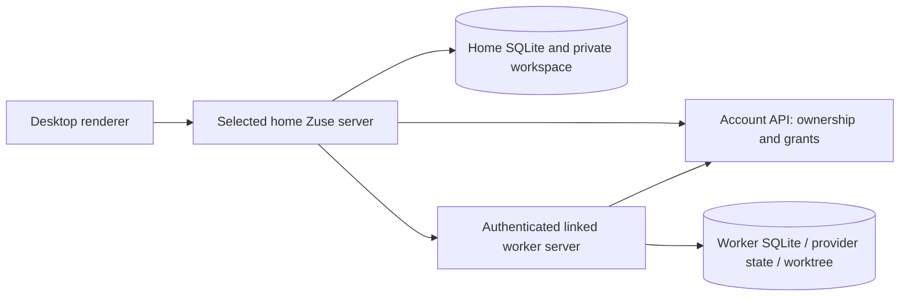

# Zots/Zots: MVP release and subsequent increments

Date: 2026-10-21. Status: implementation and release plan, not a claim of publication. `Master` remains the internal name; the current UI calls it a Zot and calls delegated ordinary chats Slaves. Codex owns backend/contracts; Opus 5.5 owns renderer implementation. The supplied product research informs attention, digest and instruction separation; schedules, Slack, external harnesses and new team-sharing semantics remain outside this plan.

Rebase update, October 22: the workspace base is now `3db1391a2` (current main at integration time). SQLite Zots is registered at 0090, API ownership at 0047, with populated preview-ledger recovery and rollback tests. The initial assessment below records the pre-rebase blockers; remaining integrated UI/release validation is still required. No release has been published.

## Decision and release boundary

Ship the current capability as an **experimental Preview MVP**, then ship independently reviewable increments. Do not delay MVP for an inbox, digest or a new layout. Existing coordination, history, instructions, memory, generated screens, local workers and cross-environment code form the candidate; implementation is not equivalent to authenticated operational validation.

At the initial pre-rebase assessment, the candidate could not be published immediately:

- Its base is `85aa432638162ab075201404633151ad72969396`, 60 commits behind fetched main `8d4bff2f48428471c1fe3866c9197a987223ff00`. The feature and other UI work are uncommitted and there is no open PR for this branch.
- The local registry assigns `0087_masters`; current main uses 0087–0089 for scratch folders/repair/device enrollment. Main's API migration 0046 is Daytona connections; this branch assigns 0046 to Zot ownership. Both collisions require additive, tested reconciliation before landing. Reconcile the obsolete unjournaled `0034_master_ownership.sql` explicitly; do not ship ambiguous duplicate migration files. Allocate numbers from main when implementing, rather than treating 0090/0047 as permanently reserved.
- Prior isolated tests passed, including a real-server restart, but they do not certify this candidate against current main/current Stable. The current desktop probe does not cover Zot records. Previously recorded full-app startup and authenticated cloud/provider smoke gaps must be closed or the affected feature explicitly gated.

Published baseline at this assessment: Stable `v0.24.0`, Preview `v0.25.0-preview.4`. Re-read releases when publishing. Reuse target 0.25.0 if still appropriate; the workflow allocates the suffix. Never claim a particular next suffix before allocation.

## Work ownership and handoff

| Owner | Exclusive implementation surface | Deliverable |
| --- | --- | --- |
| Codex | `packages/contracts`, `apps/server`, account API/migrations, shared CLI/domain adapters, backend behavior/system tests | Schemas, scoped commands, persistence, event projections, recovery and release candidate |
| Opus 5.5 | Renderer Zot views, client integration using approved contracts, shared UI reuse, renderer behavior/browser tests, associated translations | Native inbox/digest/instruction/adoption UI following the existing app design |
| Codex integration | Shared contract versions, cross-environment/system tests, migration compatibility, final review and release | One coherent candidate; no independent UI/backend release |

Reuse the existing UI Cleanup session, model `opus-5-5-1m`, rather than create a competing UI owner. Its first brief is planning/readiness only, in `.context/masters-rollout/opus-ui-brief.md`; its response belongs in `.context/masters-rollout/opus-ui-plan.md`. No new UI is bundled into MVP by starting that review. No agent renames the branch, rebases shared files, commits another agent's partial edits, changes contract packages outside ownership, or publishes independently.

Sequence each increment: Codex proposes and implements contracts with fixtures; Opus implements against those contracts, with mock fixtures where needed; Codex integrates server behavior; both run their scoped checks; integration tests gate landing. Contract changes go through Codex. Renderer/client requests never become a second orchestration engine. Each increment has one integration PR, or a contract/backend PR followed by a dependent UI PR when the addition is independently compatible. Do not land nonfunctional stub UI.

## Storage authority: local and cloud use the same model

A Zot has exactly one authoritative **home environment**. That environment's Zuse server runs coordination and writes durable Zot state. A home may be the user's desktop or a cloud workspace. A cloud home uses its own runtime SQLite and persistent runtime storage; it does not use the account API database as its conversation database.

- Desktop home: existing application SQLite under the resolved user-data profile. The renderer can close without losing state; supervision still requires the server process/device to remain running.
- Cloud home: the same SQLite schema on the workspace's authoritative persistent runtime data location. Resume must reopen that database and provider state; never initialize a replacement just because a path changed. See [runtime recovery](../cloud/runtime-data-recovery.md).
- Worker environment: owns its ordinary chats, session graph/jobs/provider state, worktrees, Git operations and native permission interactions. The home holds qualified references and last observations, not a second writable copy of worker execution state.
- Account control plane: stores home ownership, generation and repository bindings. It authenticates linked environments and issues short-lived scoped grants. It does not receive Zot transcripts, notes, generated HTML, memory or worktree contents through this feature.
- Renderer: holds view selection, temporary drafts and subscription caches. It is never the durable source of objectives, commands, decisions or permission resolutions.

There is no bidirectional database or worktree synchronization. Reading cloud work from a desktop is not moving its home. Losing the desktop cache does not lose a cloud Zot. Losing the only home disk can lose its Zot; the current control-plane row is not a backup. Cloud provider persistence and backup/retention policy must be stated accurately, not implied by account sign-in.

## Existing MVP database inventory

All `master_*` tables below live in the **home runtime SQLite**, except destination-specific tables also used by workers. Normal chats/provider sessions continue to use the existing conversation and execution tables.

| Table | Stored data and authority | Placement/recovery |
| --- | --- | --- |
| `masters` | `id`, optimistic `revision`, schema-validated `state_json`: home, generation/account-managed flag, status, settings/model/skills/limits/avatar, repositories, worker objectives/references/follow-ups/event cursors, coordinator history/active session, entries, artifact metadata, memory configuration/index/consumed fingerprints/job state | Authoritative home; updated with compare-and-swap. New optional fields require backward-compatible defaults. |
| `master_repositories` | Exclusive `(environment_id, folder_id)` owner binding | Home relational constraint plus account-wide ownership validation for linked operation. Detach removes supervision, not chats/worktrees. |
| `master_revisions` | Immutable snapshots by `(master_id, revision)` with authorship represented in entries/state | Home history; not an independent execution source. No automatic pruning in MVP. |
| `master_artifacts` | Immutable `(master_id, artifact_id, version, content)` | Markdown/screens and JSON memory pages. Memory pages include exact source evidence; Zot state stores index metadata. Workers fetch a specific version. |
| `master_commands` | Stable command ID, input fingerprint, result, phase, time and original input for pending delivery | Home outbox/receipts. Acknowledgment loss reuses the same ID; changed input under that ID fails. Retain receipts while commands can be replayed. |
| `master_target_commands` | Destination command fingerprints/results, Zot/repository scope | Executing environment. Prevents duplicate remote chats/messages; stays with the worker when home moves. |
| `master_worker_origins` | Worker session → Zot, home environment and folder attribution | Worker environment. Descriptive remote identity, no cross-database foreign key. |
| `master_interrupts` | Stable pending interruption, destination environment/folder/session | Home durable delivery intent, retried when destination reconnects. |
| `master_transfers` | One pending home move, stable command, destination, frozen transfer payload | Source recovery journal. Retain until destination activation is reconciled. |
| `master_transcripts` | Archived coordinator Markdown keyed by Zot/session | Preserves readable history across home moves. Live transcript remains owned by ordinary conversation machinery. |
| `master_snapshots` | Last-known repository chat summaries, qualified by environment/folder | Rebuildable observation cache. Offline/stale is explicit; cached status cannot authorize an action. |
| Existing conversation/execution tables | Messages, active coordinator/worker sessions, durable turns/jobs/interactions/provider checkpoints | Respective executing environment. Reuse native queues, permissions and Plan mode. |

The private workspace is `<resolved userData>/masters/<masterId>` and is separate from managed repositories. Role files and scratch files aid providers; shared durable artifacts are published through Zot storage. Arbitrary private-workspace files are **not** guaranteed to migrate or appear on another machine. Instructions belong in settings; useful notes/artifacts must be published, not left only in a local file.

The account API stores `api_master_ownership(account_id, master_id, home_environment_id, generation, repositories_json)`. It enforces account scope and a generation change on ownership updates. It is routing/fencing metadata, not a duplicate Zot store. Existing environment/account credentials remain in native auth storage/services and never enter prompts, artifacts or the generated-screen bridge.

Current revision snapshots and command results repeat aggregate JSON; large inbox payloads or digest text must not be embedded into every future Zot revision. Keep high-volume projections and immutable content in their own existing/new tables. Establish retention/export policy before adding pruning; never prune unresolved items, in-flight transfers or receipts that can still be retried.

## Local/cloud command and event lifecycle

1. UI or coordinator submits a shared scoped command with a stable ID. Validate caller, session role, Zot, destination binding, permissions and Plan mode.
2. Home saves command intent before dispatch. Local operations use the same destination path as remote operations.
3. For remote work, server obtains an account-authenticated scoped grant and sends through the linked authenticated transport. Destination checks the current owning home/generation and repository before mutation; a token alone is insufficient ownership proof.
4. Destination reconciles its receipt/deterministic chat/session/worktree identity, executes through existing native queues, and records a result. Lost acknowledgment causes reconciliation with the same ID, not a fresh task.
5. Worker durable events/reports update supervision. Current code reconciles at three-second intervals, batching wake-ups while the coordinator is busy. Do not describe this as a permanently connected exactly-once event bus.
6. Home publishes compact summaries. Transcripts, evidence and generated content load only on demand. Offline workers retain last observation and pending delivery; unknown execution reserves capacity until reconciled.
7. Pausing stops automatic dispatch; stop also records interruption delivery. User denial/manual interruption prevents queued automatic continuation. A finished turn is not proof an objective is done; successful CI is not merge approval.

Cross-environment mutations fail closed when ownership cannot be established. The supported local-only fallback when the account endpoint is absent must not silently permit remote operation. Grant renewal handles expiry; credentials stay out of context. Mixed client/server versions need explicit unsupported-capability errors, not destructive fallback/repeated creation.

## Home transfer and fresh-chat behavior

A home move requires both homes online and a settled or explicitly interrupted coordinator. Pause dispatch, stage and verify durable state, compare-and-swap the account generation, activate the destination, then reconcile source receipt/journal. Keep a fenced redirect/history on the old home. Workers and their worktrees stay where they are. Reconnecting an old home must not dispatch a second coordinator. There is no automatic failover, no migration triggered by closing the renderer, and no automatic resume on a new home while ownership is uncertain.

Existing payload carries aggregate state, artifacts/all versions, revision history, coordinator transcripts, pending source commands and interruption intents. Destination receipts and worker origin mappings stay in their original environments. Repository observation caches can be rebuilt and should initially show unknown/stale after transfer. Every new durable projection introduced below must explicitly join transfer export/import/verification. Version/capability negotiation must reject a destination that cannot preserve it before fencing the source.

Fresh coordinator chat is different from home transfer: checkpoint policy, workers, unfinished objectives, unresolved decisions and memory references; retain old transcript; create exactly one active coordinator; route later events there. Workers continue. No automatic context rollover. Learned memory is bounded retrieved data, not a substitute for current execution state or user policy.

## Increment 1: native attention inbox and trustworthy slave summaries

Outcome: one authoritative answer to “what needs me?”, available without reading every transcript. Do not add a second approval engine.

### New local persistence

- `master_attention`: `master_id`, stable `item_id`, `kind` (`permission`, `decision`, `blocker`, `delivery`, `failure`), qualified source environment/chat/session, source interaction/entry/command/turn ID, source revision/sequence, first/last observation timestamps, lifecycle (`open`/`resolved`), resolved timestamp, acknowledgment actor/time, compact title/detail JSON, row revision. Primary key `(master_id,item_id)`; index `(master_id,lifecycle,last_seen_at,item_id)` for stable paging. Stable identity is a hash of source type + qualified source ID + episode, never title text. Titles/details are projections, not new policy.
- `master_attention_cursors`: independent last processed source sequence by `(master_id,environment_id,stream_id)`. Do not steal the coordinator wake-up cursor: acknowledging or reading an inbox must not consume a supervision event. Cursor and projected rows commit in one transaction.
- Add observation metadata to `master_snapshots`: additive `observed_at` with an unknown default, plus source status if needed. Do not fabricate a global remote sequence; qualify sequences by environment/stream. Expose offline/stale/unknown/fetched-at independently.

Existing decision entries remain canonical. Permission requests remain canonical native interactions at the worker. Failed deliveries remain canonical commands/receipts. The inbox is a durable, rebuildable projection with separate acknowledgment metadata. Reconciliation cannot resolve an item just because a worker disconnects or a turn ends. Read/acknowledge does not answer/approve/resolve. When the native source settles, resolve the projection with the matching source revision. Old replayed events cannot reopen a newer resolved episode.

### Shared contract and UI seam

`ZotAttentionItem`: ID/kind/title, qualified source/evidence reference, source revision, lifecycle, acknowledgment, occurrence/observation timestamps, freshness, allowed **native action descriptors**. `masters.attention` takes Zot ID, cursor, filter and bounded limit; streamed summary includes counts/top items and continuation token. Start at 50 items/page, hard maximum 100; don't send transcripts/evidence bodies in list payloads.

`attentionAcknowledge` uses stable command ID and expected row revision. Decision answers, native permission answers, interruption and safe retries route to their existing handlers/permissions with source identity/version checks. Native action descriptors advertise intent, not executable arbitrary scripts or self-authorizing JSON. Refused/stale actions stay visible with a recoverable error. If an existing transport cannot answer a permission safely, open the worker's native permission view rather than fabricate a new remote approval path.

Opus places Needs you above activity in the existing Zot surface, with counts, source links and loading/empty/error/offline states. Keep normal chat navigation and return-to-Zot. Worker rows distinguish objective supervision, execution state, environment/model and Git/PR/CI/mergeability. Derived display states come from one shared projection; no renderer-specific definition of completion.

Acceptance: duplicate/out-of-order events yield one episode; acknowledgment never approves; denied permissions still pause follow-up; offline never resolves; stale actions rejected; local/cloud permission deep-links work; 100 chats plus concurrent streams do not load transcripts or cause full-list rerenders on token events.

## Increment 2: versioned digest

Outcome: concise “since last update / running / blocked / needs review / next” report with evidence and visible age. Native counts/status stay authoritative even if prose generation fails.

Reuse `master_artifacts` under a reserved digest namespace for immutable Markdown. Add a small optional `digest` reference/config to Zot state: current artifact/version, generator identity, source snapshot revision/watermarks, generated timestamp, state/error, last failed input identity. Do not add a parallel Markdown store, vector database or another full transcript cache. Lists return metadata/snippet only; opening the digest fetches its exact artifact version.

Generation uses bounded structured source summaries, decisions and relevant memory references, through the existing text-only provider runner. Generalize that shared runner where appropriate rather than duplicate memory's provider/tool restrictions. A deterministic input identity, durable pending job and atomic artifact/reference/job publication prevent duplicate versions for a replayed source snapshot. New source changes during generation retain a visibly older digest or invalidate/retry within an explicit cap; never relabel old content as current. Default automatic generation off until cost/latency verified; user controls manual refresh and any opt-in event-triggered updates. No new scheduler.

Expose `masters.digest` metadata/exact-version read and `refreshDigest` / `cancelDigest` / restore actions. Generated prose has provenance and is data. User edits publish a new user-authored version; subsequent model generation must not silently overwrite it. A reviewable new generated version can be accepted explicitly. Handle contradictions through evidence/decisions, not inferred policy changes.

Acceptance: restart/replayed events do not duplicate publications; stale timestamps survive offline periods; cancellation closes provider; source links survive fresh chat/home move; generated text cannot resolve native decisions or claim merge approval; an unavailable model is shown without substitution.

## Increment 3: coordinator policy versus worker instructions

Add optional `sharedWorkerInstructions` and its effective revision to Zot settings, default empty for old records. Reuse Zot revisions for author/history; no parallel settings table. Coordinator instructions say how to manage; shared worker instructions say how delegated work should execute/report; learned memory remains separate data. Skills/model profiles use the existing environment-specific catalog and availability rules.

Each newly delegated worker receives the selected instruction revision in its bounded initial context and stores that applied revision in its Zot worker reference/destination attribution. Existing workers keep their applied revision. Editing policy does **not** send messages to observed/running workers. “Send updated instructions to selected supervised workers” is an explicit normal instruction command with per-destination receipts, normal permissions and queued/offline feedback. Expose effective/applied revisions so the UI can explain the difference.

Do not reuse generic `configure` if it unnecessarily renews a coordinator when only future-worker policy changes. Add a scoped settings action with validation and history. Coordinator-affecting changes continue to follow existing checkpoint/new-session semantics; a safe point is required for active turns.

Acceptance: settings edit causes no unsolicited worker message; fresh delegation receives exact revision; concurrent edits conflict clearly; attempted worker rewriting of user policy is denied; cross-environment workers can read the referenced revision without syncing a checkout.

## Increment 4: adopt/release existing work and recovery controls

Add explicit `adoptWorker` and `releaseWorker` actions targeting a qualified environment/folder/chat/session. Adoption validates repository binding and session identity, asks for an objective, and records an active supervised reference. The first instruction/follow-up requires the user's explicit intent in the command; adoption alone must not replay the old task or manufacture completion events. Seed the event cursor at the adoption boundary, with a current observation for existing blockers. One chat may have several sessions; make which session is supervised explicit.

Release detaches supervision, cancels pending automatic instructions for that objective and removes future wake-ups; preserve ordinary chat, worktree, PR and messages. Running work continues unless the user separately interrupts it. Preserve an audit record with actor/time/reason and source identities using existing revision history. Do not confuse this operation with removing the whole repository binding.

Safe retry/reconcile actions use original command IDs and inspect destination receipts before sending. Resuming an objective after a denial is explicit; its old denied permission interaction cannot be approved by retrying an unrelated item. Retry, resume, interrupt, release and dismiss are distinct operations in the contract and UI.

Acceptance: existing chat adopted without duplication; release during a queued/offline follow-up prevents later dispatch; no worktree deletion; reopening the app preserves membership/objective; remote wrong-account/wrong-repository adoption fails; repeated commands are idempotent.

## Release sequence and rollout gates

### MVP stabilization PR

1. Freeze candidate scope and preserve a recoverable snapshot of all current UI/backend work. Rebase/reconcile the entire candidate onto current main with one integration owner; do not run concurrent rebase from UI session.
2. Resolve SQLite/API migration collisions. Test fresh main/Stable data, prior Zots ledgers (58/63/65/87 as applicable), main's scratch/device migrations, partially completed transfer and interrupted memory job. Validate existing data read-only before any runtime path change. Unknown ledgers must fail without dropping/initializing data. Repeated startup must be safe.
3. Audit generated-screen scoping, native permissions, provider role injection, command receipts, repository binding ownership and return navigation. Fix only release-critical issues; park new features above.
4. Run applicable Biome, types, architecture, i18n, backend/API/renderer behavior and real-server restart tests on the final integrated tree. Repeat the previously failing full browser/desktop startup path using the release candidate. Smoke one actual supported coordinator delegating to a worker and respecting denial; test selected local/cloud adapter combinations with authorized credentials rather than assuming simulated peers prove them.
5. Extend Preview compatibility probe: current Stable → candidate → Stable against one isolated data directory, checking SQLite integrity, ordinary chat/session/settings read/write and preservation of unknown Zot tables/artifact versions. Then candidate again to verify Zot history, memory and receipts remained intact. No destructive rollback or profile backup replacement during channel switches.
6. Create/review/land PR. Signed artifacts are built only from the exact merged main commit. No release from this dirty branch.

### Deployment ordering

1. Account API additive migration and authority/grant routes first, validated in staging and then production through the established infra deployment process. Do not deploy backend application code that requires a missing table. Mixed old clients must continue working.
2. Compatible cloud runtime/peer endpoints next, with explicit support checks before cross-environment delegation or home transfer. Confirm resumed workspaces reopen their original SQLite/provider state. Desktop release alone does not update every running cloud server.
3. Desktop Preview next, selecting the exact merged source and curated notes in `release.yml`; verification/build/signing/publication must finish. Verify macOS/Linux archives, updater manifests, hashes, prerelease status and notes. Latest Stable stays unchanged.
4. Enable local experimental use first. Advertise cross-environment operation/home transfer only after authenticated staging smoke proves both homes and worker controls. If that gate is not met, gate those controls explicitly and state the limitation in notes; don't quietly claim they work or delay local validation indefinitely.
5. Smoke a test installation's launch, creation, send-clear timing, one delegation, permission denial, restart, fresh chat, memory and update/relaunch. Stable promotion is a separate explicit decision after Preview feedback and successful compatibility validation.

### Iteration order after MVP

1. Attention + summary contract/server and native UI; no new automation triggers.
2. Digest using shared artifact/provider machinery.
3. Shared worker instruction policy and effective-revision UI.
4. Adopt/release and recovery polish.

Each increment adds its durable state to home-transfer verification and downgrade/preservation probes before exposure. Measure first meaningful summary, per-update payload/render cost and memory for at least 100 chats/concurrent streams. Establish a current-main baseline and reject regressions rather than invent unmeasured timing guarantees. Readiness is based on final-commit evidence, not earlier test counts.

## Deliberate exclusions and unresolved operational decisions

No Slack monitoring, schedules, automatic PR repair/review, external harnesses, unattended merge/deploy, team access redesign, whole-worktree sync or automatic home failover. Cloud storage backups/retention and notification delivery are separate operational capabilities; specify their actual guarantees before promising them. Bound aggregate payload/history growth and measure it; retention jobs require explicit policy and export/recovery behavior before deletion is implemented. Existing owner/account model remains; no viewer may acquire additional native approval authority just by seeing an inbox.

## Assessment evidence

Reviewed current Zot contracts/store/migration/service/peers, account ownership routes, UI implementation notes and desktop release workflow/guide. Fetched main and queried current releases on October 21. Earlier tests are recorded in [implementation notes](README.md) and [memory notes](memory.md); they are historical evidence, not a fresh release certification. This planning change itself adds no runtime behavior; Markdown whitespace/link checks apply, runtime checks are the stabilization gates above.

### Review status at handoff

A separate read-only backend readiness review confirmed destination-side generation/repository checks, scoped peer tokens, command receipt/deterministic-identity reconciliation, and staged/CAS home transfer. It independently confirmed both migration collisions and the lack of a current integrated release certification. It did not execute new behavior tests or authenticated provider calls. The existing Opus 5.5 UI owner has received both the planning brief and this contract/storage plan; UI recommendations are pending. Only documentation was changed for this planning step; no proposed iteration is implemented or published by writing this plan.
